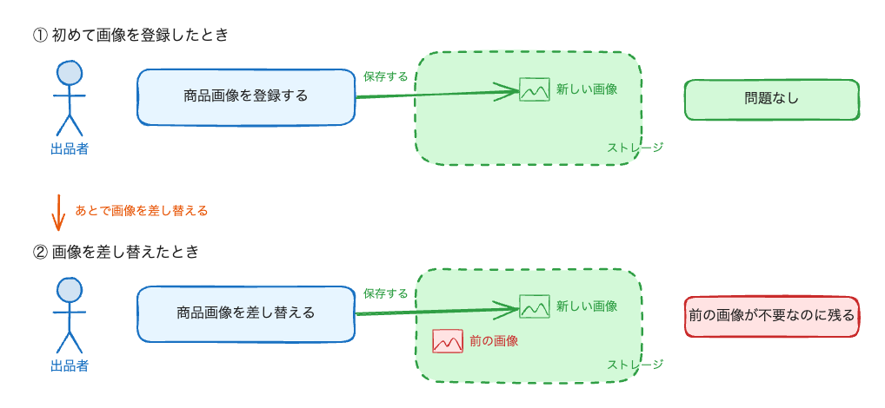
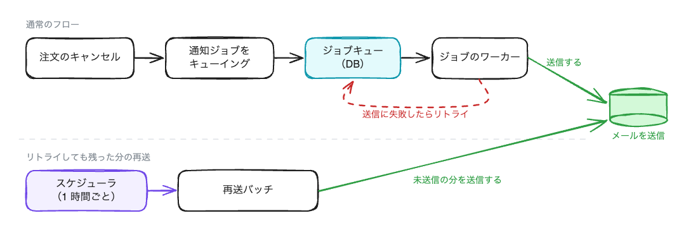

# Excalidraw Diagrams

[Skill catalog](../README.md)

ドキュメント、チケット、PR 本文、インラインコメントに載せる図を、Excalidraw で描いて PNG にするスキルです。
伝えたいことに合わせて 4 つの型（現状のシナリオ、問題、時系列の処理、仕組み）から選び、読み手が知っている言葉の短いラベルと、役割ごとにそろえた色で描きます。
図は Python の生成スクリプトから `.excalidraw` として書き出すので、直すときはスクリプトを直して再生成でき、excalidraw.com で開いて手で直すこともできます。

## 使い方

```text
$excalidraw-diagrams で、この設計書の「解決したい課題」に、問題が起きない場面と起きる場面を並べた図を入れてください。
```

```text
$excalidraw-diagrams で、この PR の再試行の流れを図にして、本文に載せる案を作ってください。
```

Claude Code では、プラグイン名を含むスラッシュコマンドでも呼び出せます。

```text
/aburasashi:excalidraw-diagrams 通常の流れと失敗したときの流れを図にしてください。
```

## 例

| 問題 | 仕組み |
| --- | --- |
|  |  |

生成スクリプトは [problem.py](assets/example/problem.py) と [mechanism.py](assets/example/mechanism.py) です。

## PNG への変換

```bash
uv run --with playwright==1.62.0 python scripts/render.py assets/example/problem.excalidraw
```

Playwright の Chromium か、インストール済みの Google Chrome で描画します。
Excalidraw のライブラリを esm.sh から読み込むため、ネットワークへのアクセスが必要です。

## 適用範囲

- 対象：設計書、調査結果、チケット、PR 本文、インラインコメント、レビュー返信に載せる図。
- 対象外：ターミナルでの返答（`japanese-native-writing` のテキストのフロー図）、表で済む比較、実際の画面のスクリーンショット。
- 図の周りの文章：`japanese-doc-writing` と `japanese-pr-writing` に従います。
- 外部への書き込み：共有されているドキュメントや PR に載せる前に、画像と差し込む位置を示して確認をもらいます。

[SKILL.md](SKILL.md)に基準を記載しています。
